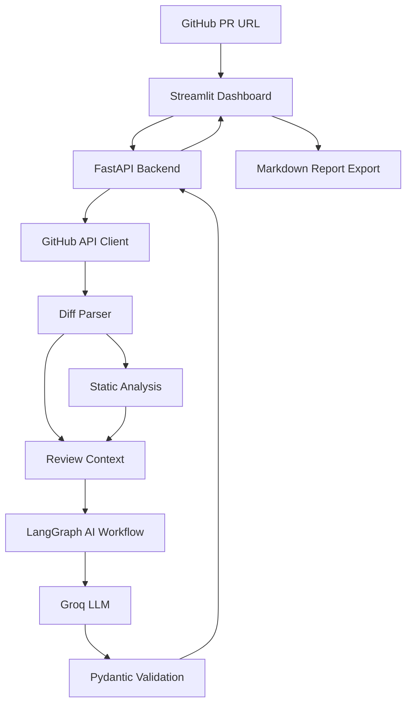

# PR Review Intelligence Assistant

**An AI-assisted pull request review preparation tool for engineering mentors and developers.**

The PR Review Intelligence Assistant combines deterministic static checks and LLM-based analysis to summarize code changes, identify potential risks, suggest tests, and generate educational review reports.

Built as a proof of concept for the Cynbit AI/ML Engineer Intern assessment.

---

## Demo Overview

Submit a public GitHub pull request URL to receive:

- PR summary and change statistics.
- Potential bugs and maintainability observations.
- Selected static-analysis findings.
- AI-generated recommendations.
- Test suggestions.
- Positive engineering observations.
- Review report export in Markdown.

> AI-generated findings are advisory. Human reviewers remain responsible for validating findings and making engineering decisions.

---

## Architecture



---

## Tech Stack

| Technology | Usage |
|---|---|
| Python | Core development |
| FastAPI | Backend API |
| GitHub REST API | PR data retrieval |
| LangGraph | AI workflow orchestration |
| Groq | LLM inference |
| Pydantic | Structured output validation |
| Streamlit | Dashboard |
| pytest | Automated testing |

---

## Project Structure

```text
PR-Review-Intelligence-Assistant/
├── backend/
│   ├── main.py
│   ├── github_client.py
│   ├── diff_parser.py
│   ├── schemas.py
│   ├── static_analysis.py
│   ├── prompts.py
│   └── graph.py
├── frontend/
│   └── app.py
├── tests/
├── reports/
│   ├── opportunity_report.md
│   └── technical_approach.md
├── data/
│   └── sample_diffs/
├── .env.example
├── .gitignore
├── requirements.txt
└── README.md
```

---

## How It Works

1. Submit a public GitHub PR URL.
2. Retrieve PR metadata and patches.
3. Parse added and deleted lines.
4. Run deterministic checks against added Python code.
5. Send review context to the AI workflow.
6. Generate a structured AI review.
7. Display the findings in the dashboard.
8. Export a Markdown review report.

---

## Static Analysis Checks

The current prototype includes selected heuristic checks:

| Rule | Description |
|---|---|
| SEC001 | Detects `eval()` usage |
| SEC002 | Detects `exec()` usage |
| SEC003 | Detects `subprocess` with `shell=True` |
| SEC004 | Detects potential hardcoded credentials |
| CODE001 | Detects bare `except` |
| CODE002 | Detects `print()` usage |

These rules are intentionally limited and may produce false positives or miss issues.

---

## AI Review Output

The AI review provides:

- Summary.
- Risk level.
- Findings.
- Evidence.
- Explanations.
- Recommendations.
- Test suggestions.
- Positive observations.
- Limitations.

The system does not automatically approve, reject or merge pull requests.

---

## Installation

### 1. Clone the repository

```bash
git clone https://github.com/YOUR_USERNAME/PR-Review-Intelligence-Assistant.git
cd PR-Review-Intelligence-Assistant
```

### 2. Create a virtual environment

Windows:

```powershell
python -m venv venv
venv\Scripts\activate
```

Linux/macOS:

```bash
python -m venv venv
source venv/bin/activate
```

### 3. Install dependencies

```bash
pip install -r requirements.txt
```

### 4. Configure environment variables

Create a `.env` file in the project root:

```env
GROQ_API_KEY=your_groq_api_key
```

Never commit your `.env` file.

### 5. Start the backend

```bash
uvicorn backend.main:app --reload
```

Backend:

http://127.0.0.1:8000

Swagger documentation:

http://127.0.0.1:8000/docs

### 6. Start the frontend

Open another terminal:

```bash
streamlit run frontend/app.py
```

Dashboard:

http://localhost:8501

---

## API

### POST `/analyze`

Request:

```json
{
  "pr_url": "https://github.com/owner/repo/pull/123"
}
```

The API returns PR metadata, file summaries, parsed changes, static findings, AI analysis and statistics.

---

## Testing

Run:

```bash
python -m pytest -q
```

---

## Security

- API keys are stored in environment variables.
- Submitted code is treated as untrusted input.
- No arbitrary code execution is performed.
- AI findings are advisory.
- Human review remains necessary.

---

## Limitations

- Public GitHub PRs only.
- Limited deterministic static-analysis rules.
- AI output may be inaccurate.
- Evidence and line references are not independently verified yet.
- No automated execution of PR tests.
- No production deployment or formal evaluation completed.

---

## Assessment Reports

- [AI Opportunity Report](reports/opportunity_report.md)
- [Technical Approach Report](reports/technical_approach.md)

---

## Future Roadmap

- Evidence validation.
- More static-analysis rules.
- Chunked review for large PRs.
- Repository-context retrieval.
- Reviewer feedback and evaluation.
- GitHub integration.
- Docker deployment.
- CI/CD integration.
- Observability and tracing.

---

## Disclaimer

This project is a proof of concept. AI-generated findings should be reviewed and validated by qualified developers.

---

**Built with Python, FastAPI, LangGraph, Groq and Streamlit.**
```

Save it.

---

## Step 14 — Before we push to GitHub

We have three critical checks remaining:

1. <text color="success" weight="medium">Security check</text> — prevent API keys from being exposed.
2. <text color="success" weight="medium">GitHub packaging</text> — repository, commits and files.
3. <text color="success" weight="medium">Assessment submission</text> — submit the public repo and setup notes.

### First: show me your `.gitignore`

Open your `.gitignore` in VS Code and paste its contents here.

I want to check that your Groq API key, virtual environment and local files won't accidentally be pushed to GitHub.